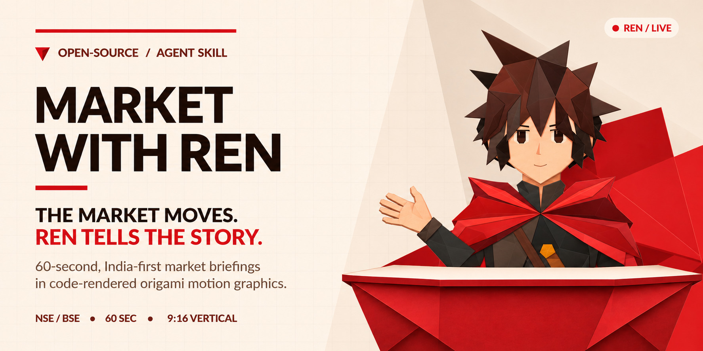

# MARKET WITH REN

**A code-rendered origami market briefing skill, presented by Ren.**



**Live website & interactive preview:** [market-with-ren.vercel.app](https://market-with-ren.vercel.app/) — explore the skill, installation steps, and Ren's visual demo (no audio in the website preview).

Market with Ren is an agent skill for producing **60-second, vertical stock-market videos** in a consistent folded-paper visual style. Ren, a reusable animated origami news anchor, presents India-first coverage: **Nifty 50, Sensex, sectors, stocks, institutional flows, macro signals, and the next trading session's calendar**.

The repository contains the production instructions, episode templates, research and quality-control guidance, animation assets, and helper scripts. It is a **skill and production toolkit**, not a one-click video-generation website or a source of live market data.

## At a glance

| | Default |
| --- | --- |
| Show | **MARKET WITH REN** |
| Coverage | Indian markets (NSE/BSE), with relevant global context |
| Formats | Post-close recap, pre-market brief, weekly wrap |
| Episode | 60 seconds, approximately 10 editorial beats |
| Video | 1080 × 1920 (9:16), 30 fps |
| Delivery | H.264 MP4, AAC audio |
| Look | Origami / folded-paper motion graphics |
| Anchor | Ren, waist-up in the bottom-right |
| Production | HTML, CSS, SVG, Canvas, JavaScript, Python, FFmpeg as available |

## What the skill does

- **Research and organize market movements** into a source-backed price ledger with timestamps.
- **Select and script a short episode** with a recognizable opening, clear market numbers, concise catalysts, and an outlook.
- **Plan origami scenes** with price cards, ticker ribbons, charts, lower thirds, captions, and transitions.
- **Animate Ren** with reusable expressions, gestures, eye controls, and mouth cues.
- **Prepare narrated videos** with subtitles and mouth animation timed to measured speech.
- **Validate episodes** for missing information, inconsistent beat timing, unsupported presets, and other production errors.

The main specification is [SKILL.md](SKILL.md). Read that file first when using the skill with an AI coding or media-production agent.

## Quick start

### 1. Get the repository

```bash
git clone https://github.com/aruchith08/Market-with-Ren.git
cd Market-with-Ren
```

Load this repository's [SKILL.md](SKILL.md) in an agent environment that supports skills or repository-based instructions. If your environment does not automatically discover skills, explicitly ask the agent to read that file.

### 2. Scaffold an episode

```bash
python scripts/init_episode.py market-close --output episodes/market-close
```

The scaffold provides starter research, editorial, and planning files based on the bundled templates. Replace placeholder material with **verified market data**; scaffolding does not fetch prices or render an MP4.

### 3. Build the story

Gather exchange-backed numbers and source URLs, with an `as_of` timestamp for every data point. Then develop the beat lineup, narration, and scene plan. A typical post-close episode moves from Nifty/Sensex to catalysts, gainers and losers, sectors, FII/DII flows, macro signals, and the next session's watchlist.

See [prompt templates](references/prompt-templates.md) for ready-to-adapt instructions.

### 4. Validate the episode

```bash
python scripts/validate_episode.py episodes/market-close
python scripts/validate_episode.py episodes/market-close --strict
```

Use the first command during drafting and `--strict` before final export. Validation checks the episode artifacts; it does **not independently verify that a market quote is true**.

### 5. Prepare Ren and render

Start with the [Ren agent quickstart](assets/ren-character-engine/docs/AGENT_QUICKSTART.md). The reusable character renderer lives in `assets/ren-character-engine/`.

For example, from that directory:

```bash
cd assets/ren-character-engine
node tests/test.js
node scripts/render.js --emotion focused --mouth AA --pose present --still --out out/ren.svg
```

For moving scenes, prepare an example scene JSON, validate it, and render it using the engine's documented commands. Assemble the full episode with your available browser/SVG compositor and FFmpeg or another supported code-based rendering workflow. **A full 60-second exported video requires a compatible rendering setup, narration, and completed data; the top-level scaffold and validator alone do not generate it.**

## Example prompt

```text
Use the Origami Market Video skill in post-close mode.
Produce a 60-second vertical Market with Ren episode for today's
Indian trading session.

Gather and timestamp verified Nifty 50, Sensex, sector, mover,
FII/DII, and relevant macro figures. Prepare the price ledger,
10-beat editorial plan, narration, scene plan, subtitles,
and origami visuals with Ren as the bottom-right anchor.

Keep it factual, cite the sources, and do not give buy/sell advice.
Use the bundled Ren engine and the available code renderer;
do not assume a Remotion plugin is installed.
```

Additional prompts cover pre-market sessions, a single market theme, movers-only recaps, Ren overlays, and updates to an existing episode: [references/prompt-templates.md](references/prompt-templates.md).

## Production workflow

```text
Verified market sources
        ↓
Price ledger + source timestamps
        ↓
Story selection + short narration
        ↓
Storyboard + scene plan
        ↓
Origami cards, charts + animated Ren
        ↓
Voiceover + speech-aligned mouth cues + captions
        ↓
Validation + visual/audio QA
        ↓
MP4 + publishing description/pinned disclaimer
```

The standard editorial timeline is **0–4 seconds intro**, **4–55 seconds market beats**, and **55–60 seconds outro**. Adjust beat count for the day's actual story rather than padding an uneventful session.

### Narration and lip sync

The skill specifies a consistent male English anchor voice. Audio is generated separately, measured, and used to time the scenes and Ren's mouth cues. The mouth engine does not analyze audio automatically.

```bash
python scripts/build_speech_cues.py <cues.json> --check
```

Run the checker on a prepared cue JSON. If narration or timing changes, rebuild the cues before export. See [SKILL.md](SKILL.md) for the complete audio-first workflow.

## Repository guide

```text
Market-with-Ren/
├── SKILL.md                         # Authoritative agent skill specification
├── agents/openai.yaml               # Skill display metadata
├── scripts/
│   ├── init_episode.py              # Episode workspace scaffold
│   ├── validate_episode.py          # Episode consistency checks
│   ├── build_speech_cues.py         # Narration-to-mouth cue helper
│   └── prepare_desk.py              # Origami news desk asset helper
├── references/
│   ├── workflow.md                  # Production workflow
│   ├── visual-spec.md               # Show visual system
│   ├── source-and-qc.md             # Sourcing and QA
│   ├── ren-quickref.md              # Character reference
│   └── prompt-templates.md          # Example agent prompts
└── assets/
    ├── ren-character-engine/        # Ren renderer, presets, examples and docs
    ├── props/                       # Origami scene props
    └── templates/episode-template/  # Research and editorial starter files
```

A source ZIP is also included in the repository for convenience; the unpacked directories are easier to browse, reference, and maintain.

## Design principles

**Origami from end to end.** Folded-paper styling carries through the anchor, backgrounds, charts, ticker ribbons, price cards, and transitions—not just Ren.

**Facts before graphics.** Every displayed market number needs a traceable source, value, and timestamp. Prefer official exchange data when sources conflict; never invent a missing quote.

**Consistent character.** Ren's shape, palette, desk placement, expressions, and gestures are controlled through the bundled engine and presets. Avoid redrawing the character between episodes.

**Readable on a phone.** Headlines and price movements remain prominent, with room for platform UI, captions, charts, and Ren.

**Reproducible by code.** Prefer composited SVG/HTML/Canvas and reusable templates over AI-generated footage. Do not assume a particular video plugin is available.

## Requirements and limitations

- **Python 3** for the top-level scaffold, validation, and cue utilities.
- **Node.js** for the bundled Ren character rendering and tests.
- A **browser-based renderer and/or FFmpeg**, depending on the final export pipeline.
- A separate **TTS or narration source** and audio tools for spoken episodes.
- Access to **current, trustworthy market sources** for each requested session.

Not every rendering, speech, or market-data integration is bundled or available offline. Follow the environment-specific instructions in [SKILL.md](SKILL.md) and the [Ren engine documentation](assets/ren-character-engine/docs/AGENT_QUICKSTART.md).

## Market-content policy

This is an editorial and motion-graphics workflow, **not an investing system**. Do not generate buy/sell/hold calls or unsupported predictions. Keep source information and price timestamps auditable. Include the skill's prescribed disclaimer in the publishing description and pinned comment; see [SKILL.md](SKILL.md) for the exact text and delivery requirements.

---

**Created and maintained in [aruchith08/Market-with-Ren](https://github.com/aruchith08/Market-with-Ren).**
